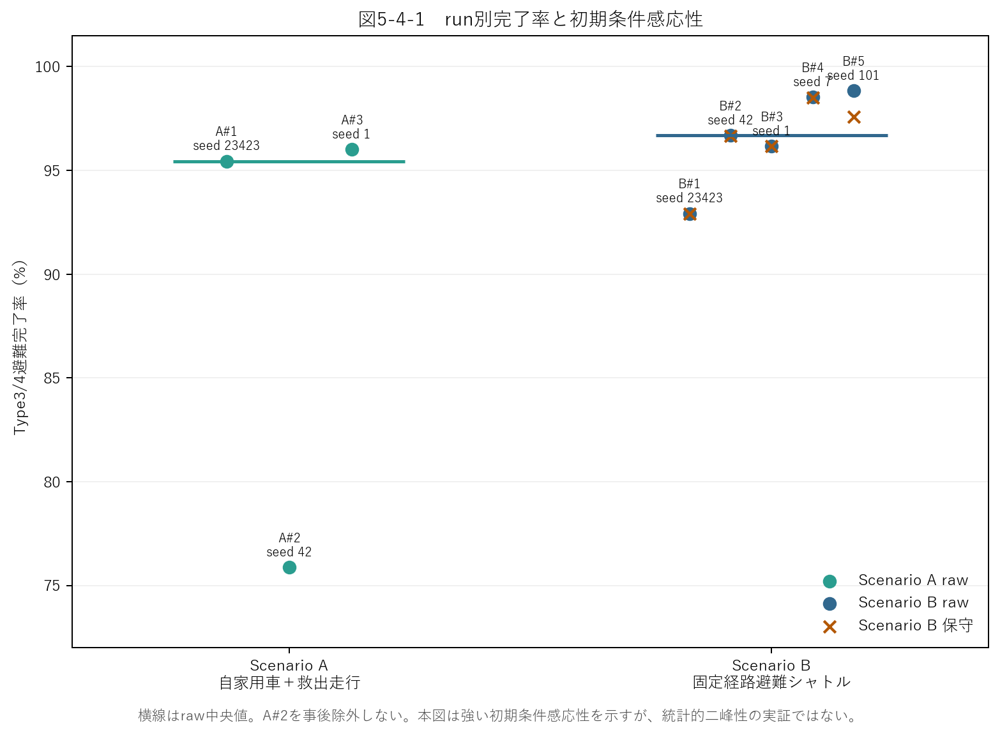
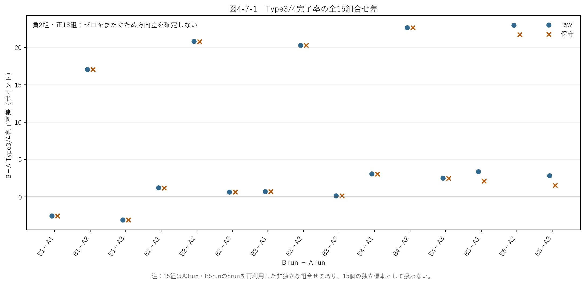

# 中間発表 予稿原稿 v03

> 作成日：2026年11月6日  
> 用途：2026年12月5日中間発表のWord予稿へ反映する本文案  
> 掲載範囲：修正前原稿の内容基準日である2026年10月28日を引き継ぎ，後続系列の結果は追加しない．  
> 構成・記述：[予稿構成・記述定義](中間発表_予稿構成・記述定義.md)に従い，先生の添削を反映した．  
> 書式：である調，句読点「，」「．」．WordはA4・本文2段組・2ページを想定する．ページ数の確認はWord化時に行う．

---

# デマンド交通の災害時活用政策提案

眞坂研究室　氏名：古賀玲次

## 1. はじめに

デマンド交通は，自家用車を自由に運転できない高齢者などの移動手段として住民の生活を支えているが，運行費用の面から継続性が課題となる地域が多い[1]．本研究では，その維持継続に資する新たな価値として，災害時の避難支援への活用可能性に着目する．

対象事例は，平成27年9月関東・東北豪雨に伴う鬼怒川氾濫である．2015年9月10日，茨城県常総市三坂町付近で鬼怒川左岸の堤防が決壊し，市域の広い範囲が浸水した[2][3]．本稿では，避難所への到達可能性を分析したうえで，デマンド交通の活用を周辺道路の渋滞緩和と移動困難者支援の2つの視点から検討する．

## 2. 現状の分析

水害時の自動車避難では，車両が動けなくなる危険や避難経路上の混雑が指摘されている[4]．そこで，支援政策を検討する前提として，道路閉鎖によって避難所への経路が失われる地域を調べた．

### 2.1 対象地域と使用データ

常総市の道路網を対象とし，国土地理院の浸水範囲8時点[2]と洪水浸水想定区域[5]から道路閉鎖を設定した．浸水想定区域は常総市の行政界[5]で切り出し，浸水深0.5m以上の区域を使用した．道路網はOpenStreetMap[6]から取得し，車両の動きを計算する際には交通シミュレータSUMO[7]用に変換した．出発地と人口には250mメッシュ人口[8]，避難所には避難施設データ[5]を用いた．市域外への流出入は扱わない．

### 2.2 静的分析による避難所への到達可能性

道路網12,860区間と避難所19施設を用い，初期の浸水範囲を基に抽出した40メッシュ・2,257人について経路を探索した．静的分析では，8時点それぞれの閉鎖状態を固定して経路の有無を判定し，車両の移動や渋滞は計算しない．一度閉鎖した道路は再開しない条件としたため，累積閉鎖区間数は最初の168区間から次時点の764区間へ増え，以降は一定となった．

いずれの時点でも17メッシュ・952人，対象人口の42.2%に避難所への経路がなかった．これは対象メッシュの道路網上の到達可能性を示す結果であり，市全体の被災割合や実際の逃げ遅れ人数を示すものではない．

## 3. 支援政策の提案

道路閉鎖による経路の喪失に加え，避難車両の集中と，自家用車を利用できない人の移動手段が課題となる．そこで，既存のデマンド交通車両を災害時に活用する政策を，以下の2つの視点から検討する．

### 3.1 デマンド交通活用による周辺道路渋滞緩和

乗合輸送によって避難時の車両数を抑えることを政策の狙いとし，まずバスを導入しない場合の交通状況を確認した．初期の対象人口2,257人から車両1,001台を設定し，SUMOとTraCIを用いて，時刻に応じた道路閉鎖と車両の迂回を計算した．

60秒間隔の路線別記録では，県道357号で最大137台，うち停止車両の最大値は105台となり，路線内の車両平均速度の最低値は1.64m/sであった．国道294号でも最大61台，停止車両最大7台，平均速度最低4.41m/sとなり，車両の集中と速度低下を確認した．各指標の最大・最低値は，必ずしも同じ時刻の値ではない．

ただし，この計算は停止した車両を300秒後に先へ移す設定を含む単一試行である．このため，結果は交通集中が生じる箇所の観測として扱い，渋滞による逃げ遅れの有無やバスによる緩和効果の根拠とはしない．渋滞緩和の効果については，同じ条件でのバス導入前後の渋滞指標による評価が課題である．

### 3.2 デマンド交通による移動困難者支援

支援対象者は，洪水浸水想定区域にかかる405メッシュについて，車非保有率を15%と仮定し，メッシュごとの高齢者・非高齢者人口に適用して整数化した．その結果，自家用車を利用できない人を，高齢者935人，非高齢者2,320人，計3,255人と設定した．15%はモデル上の仮定であり，実際の車利用の可否を調査した人数ではない．この対象範囲は2.2の40メッシュとは異なる．

自家用車と迎えの車で避難する条件Aと，これに小型乗合車両5台を固定経路バスとして加える条件Bを比較した．迎えの車は，自家用車を使えない世帯に送迎が提供される仮定であり，出発地と迎車地点を同じメッシュの道路に設定した．運転者と利用者の関係や協力の可否は再現しておらず，実際に家族等が迎えに来ることを確認したものではない．

完了率は，迎えの車の到着台数を1台2.3人で換算し，バスの到着人数を加えて求めた．共通分母は，条件Aの迎え車1,405台から換算した3,231.5人相当であり，人口分類の3,255人とは推計方法が異なる．図1のとおり，完了率の中央値はAが95.44%（3試行），Bが96.68%（5試行）であったが，全15通りの差は−3.09〜+22.97ポイントに広がった．本モデルの分解能では方向性のある差を検出できず，効果がないことや両条件が同等であることを示すものではない．

**図1．固定経路バス比較の試行別完了率(a)と条件B−Aの15通りの差(b)**

図1の15通りの差は同じ試行を組み合わせており，互いに独立ではない．また，本比較では未乗車者や予約からの待ち時間を把握しておらず，支援を受けられなかった人の評価が残る．

## 4. まとめと今後の課題

静的分析では，対象メッシュの約4割の人口について避難所への経路が失われ，動的計算では主要道路への車両集中と速度低下を確認した．一方，固定経路バスの比較では，避難完了率の方向性のある差を検出できなかった．

今後の課題は，渋滞緩和と移動困難者支援をそれぞれの指標で評価すること，迎えの車が必ず提供される仮定の限界を検討することである．予約型配車では，待ち時間，要支援度，道路閉鎖の予測を用いる方式を比較し，個人ごとの避難結果と未乗車理由を把握する．また，大型バスによる巡回輸送など，他の活用方法も検討する．結果は各モデルの条件の範囲で解釈し，実災害での政策効果へ直接一般化しない．

## 参考文献

[1] 国土交通政策研究所：多様な地域公共交通サービスの導入状況に関する調査研究，https://www.mlit.go.jp/pri/houkoku/gaiyou/kkk147.html，閲覧日：2026年5月28日．

[2] 国土地理院：平成27年9月関東・東北豪雨の情報，https://www.gsi.go.jp/BOUSAI/H27.taihuu18gou.html，閲覧日：2026年5月20日．

[3] 国土交通省関東地方整備局下館河川事務所：鬼怒川緊急対策プロジェクト，https://www.ktr.mlit.go.jp/shimodate/shimodate00166.html，閲覧日：2026年5月20日．

[4] 政府広報オンライン：防災特集 ACTION02 発災時の行動，https://www.gov-online.go.jp/tokusyu/bousai/disaster.html，閲覧日：2026年5月28日．

[5] 国土数値情報ダウンロードサイト：洪水浸水想定区域（A31a）・行政区域（N03）・避難施設（P20），https://nlftp.mlit.go.jp/ksj/，閲覧日：2026年6月7日．

[6] OpenStreetMap contributors：OpenStreetMap，https://www.openstreetmap.org/，閲覧日：2026年6月7日．

[7] Lopez, P. A. et al.: Microscopic Traffic Simulation using SUMO, 2018 21st International Conference on Intelligent Transportation Systems, pp.2575-2582, 2018.

[8] 総務省統計局：地域メッシュ統計（250mメッシュ人口），https://www.e-stat.go.jp/gis，閲覧日：2026年6月7日．

---

## 修正・確認メモ（提出本文には含めない）

### 変更点と先生のコメントへの対応

- コメント0・5：研究の着眼点を明示し，「現状の分析」から2つの「支援政策の提案」へつなぐ4章構成に変更した．
- コメント1〜4：常総市境界による切り出し，40メッシュの対象範囲，各時点を固定した経路探索，閉鎖を累積する条件を説明した．
- コメント6・赤字の結果掲載指示：既存の路線別記録から車両数，停止車両数，平均速度を再集計した．旧単一試行・車両の移動処理を含む条件に限定し，渋滞緩和の実証とは扱っていない．
- コメント7：405メッシュの年齢別人口に15%の仮定を適用し，整数化して3,255人を得る処理を確認した．ただし，年齢別人口の整合性には下記の未解決事項がある．
- コメント8：迎車地点と車両出発地点が同じ道路であることを全405行で確認した．家族・知人関係の実証はなく，先生の現実性への疑問が解消したとは扱わない．
- コメント9：予約型配車の詳細な独立章を設けず，既存比較の課題に接続して4章へ整理した．先生の保留が解除されたことは意味しない．
- 旧原稿で区別されていなかった人口参照値3,255人と完了率の共通分母3,231.5人相当を分けて記載した．指標の定義や凍結済み結果は変更していない．

### 既存成果物との照合

以下は2026年11月6日に行った読取・再集計の記録である．研究runの追加実行，元CSV・設定・凍結結果の変更は行っていない．リンク先は本研究フォルダー内の既存成果物である．

| 照合対象 | 元資料・成果物 | 確認内容 |
| --- | --- | --- |
| 静的分析 | [出発地](../../../../04_プログラム/output/agents/origin_points.csv)，[到達不可](../../../../04_プログラム/output/routes/unreachable_agents.csv)，[閉鎖時系列](../../../../04_プログラム/output/closure/road_closure_timeline.json) | 出発地40行・人口2,257人．各時点17行・952人．時点をまたぐ人数の重複加算なし．累積閉鎖168→764区間を再計算 |
| 渋滞の観測 | [路線別60秒ログ](../../../../04_プログラム/output/sumo/results/scenario_a_major_route_congestion_log.csv)，[集計表](../../../../04_プログラム/output/sumo/evaluation/major_route_congestion_summary.csv)，[実行概要](../../../../04_プログラム/output/sumo/results/scenario_a_traci_summary.json) | 各路線360観測．県道357号と国道294号の最大車両数・最大停止台数・最低平均速度を元ログから再集計して一致．平均速度は各時点の路線内車両数で重み付けした値 |
| 人口分類 | [405メッシュの分類](../../../../04_プログラム/output/sumo/regions/08211/derived/agent_types.csv)，[分類処理](../../../../04_プログラム/scripts/p2_phase3_prep_agents.py) | 全行で年齢別人口×0.15の丸めと分類人数が一致．高齢者935人・非高齢者2,320人を再集計 |
| 迎えの車 | [迎車OD](../../../../04_プログラム/output/sumo/regions/08211/derived/rescue_od.csv)，[生成処理](../../../../04_プログラム/scripts/p2_region_pipeline.py) | 405行の迎車地点と車両出発地点が一致，迎車停車60秒．条件Aの迎え車計1,405台．家族関係等の情報なし |
| 固定経路バス比較 | [正式run一覧・SHA](../../../../06_研究結果/phase3/Phase3_正本manifest_20260720.md)，[run別記録](../../../../04_プログラム/output/sumo/regions/08211/evaluation/phase3r_e1_replicate_metrics.csv)，[固定集計](../../../../04_プログラム/output/sumo/regions/08211/evaluation/phase3r_e1_band_summary.json) | A3試行・B5試行の到着台数×2.3＋バス到着人数を3,231.5で除し，既存率と照合．中央値95.44%・96.68%，全15組差−3.09〜+22.97ポイントを再計算．失敗run・後続系列は追加していない |
| 解釈 | [結論固定](../../../../06_研究結果/研究結果・結論固定_20260721.md) | 方向差非検出，同等性・効果なしを意味しないという結論を保持 |

照合に用いた主要成果物のSHA-256を記す．

| 成果物 | SHA-256 |
| --- | --- |
| `origin_points.csv` | `cd2a4268763f235d93ae7b87bffe13ad71fb71dc4251e6cbcc26156584602e7c` |
| `unreachable_agents.csv` | `327a47c8eeb1f1484eddce2f59f15f4407657ff0d12a42ef76ab9bfbac9497b2` |
| `road_closure_timeline.json` | `ea711f08eeaa68a9cd84e3aa53a0ae4df9e5aa00f67a4f291e696a2ea5d05e76` |
| `scenario_a_major_route_congestion_log.csv` | `7e24582aefe3d1f03568b0a25e7ba941b3a9a9821709340493d2bdec282ca409` |
| `agent_types.csv` | `1d38fefd691c83b44a6b148678cce2fa4f7595ae2991e9291a7fb10d605f1c72` |
| `rescue_od.csv` | `493dbc46b7fad53b9ed65129bf5127dd3091a0a9a07ad6a82f4bba4ea3e2050b` |
| `phase3r_e1_replicate_metrics.csv` | `f4851017723009385f9f993cc1ffa89dead36bbda114516dc994d9aa74fc3625` |
| `phase3r_e1_band_summary.json` | `36a40f6379d4aee7c9389de3cd67966a3457a72b4ee67b94a49c7f92d50f5720` |

### 提出前に残る確認

1. **年齢別人口の不整合**：`agent_types.csv`では総人口21,539人に対して，高齢者6,191人と非高齢者15,433人の合計が21,624人となり，85人多い．高齢者数が総人口を上回るメッシュが2行あり，処理が非高齢者人口を0以上にするため，この超過が生じることを確認した．入力の秘匿・年齢人口の扱いなど上流の原因は未確認である．3,255人は既存モデルの設定値として説明し，正しい対象人口を実証したとは主張しない．本文では上記の年齢別合計を根拠に新たな人口推計を行っていない．凍結条件を変更せず，入力の意味と限界の説明を確認する必要がある．
2. **迎えの車の現実性**：出発地点と迎車地点が同じ道路に置かれ，誰が誰を迎えるかはモデル化されていない．文章の言い換えだけでこの仮定が妥当になるわけではない．迎えが常に提供される比較であることと，政策解釈への影響を先生に説明する．
3. **渋滞結果の適用範囲**：初期対象2,257人・1,001台の旧計算と，405メッシュを用いる固定経路バス比較は別の対象設定である．両者をバス導入前後の同条件比較として図示しない．路線別指標は60秒ごとの観測上の極値であり，連続時間での真の最大・最低値とは限らない．
4. **図1と紙面**：本Markdownでは既存画像2点を図1(a)(b)として参照した．Wordでは横並びの1図に組み，軸・単位・対象と非独立性の注記を残す．本文と参考文献が2ページに収まることは未確認である．
5. **後続研究の時制**：予約型配車は先生が保留とした箇所であり，4章は研究課題との接続を示す記述である．実験の進捗や掲載範囲を更新する場合は，結果確定日と対象系列を改めて確認する．
6. **参考文献**：既存の8件と閲覧日を継承した．今回，外部Webの再閲覧や出典の適合性の再監査は行っていない．
