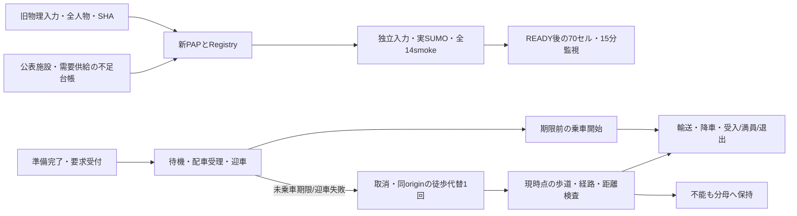

# JDRT受付・代替行動：独立データ・状態遷移図 v1

2026-10-17。研究設計登録済み、技術未READY。旧図を保全して新規作成。

[HTML図](JDRT_受付代替行動_データ・状態遷移_v1.html) / [SVG図](JDRT_受付代替行動_データ・状態遷移_v1.svg) / [PAP](../jdrt/常総市JDRT_受付代替行動_PreAnalysisPlan_v1.md)。

図は入口測量や運行実態の観測結果ではない。新しい900秒未乗車期限、5/50%需要、施設優先、入力時刻一致予測を仮定/診断と区分する。乗車開始後は原点へ戻らず、取消車両の位置を初期化しない。詳細の時刻不等号・要求/人物別会計は状態遷移仕様を正本とする。
