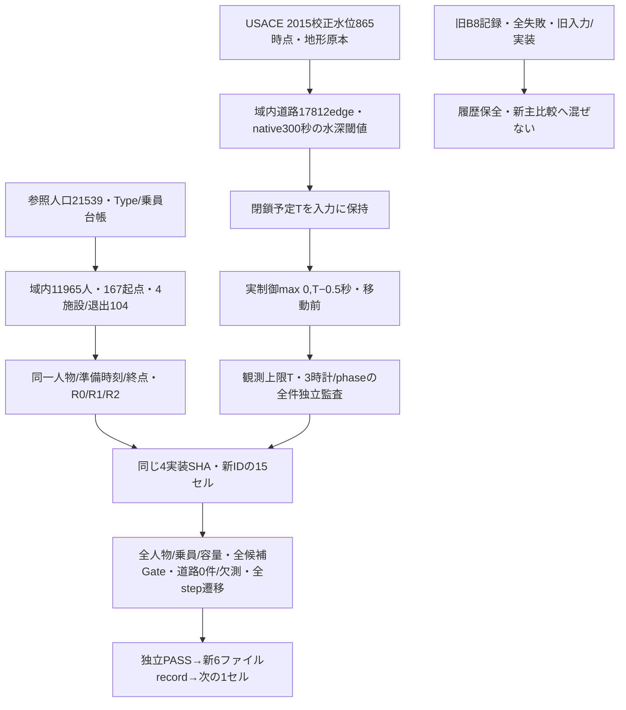

# 実時間B 境界整合系列：物理データと3つの時計

作成：2026-10-16T18:15:59.143090+09:00。新protocol=`realtime_b_boundary_v2`。ユーザー提案1採用。旧図解を残して作成した独立v2。

| 時計 | 定義 | 例：予定5400秒 |
|---|---|---:|
| scheduled_sec | native閉鎖予定T | 5400.0 |
| control_call_sec / time_sec | 実際の物理制御呼出しmax(0,T−dt) | 5399.5 |
| observation_upper_sec | 制御後stepの観測上限T | 5400.0 |

初期T0は呼出し0、終了T21600は21599.5で適用。先行は最大0.5秒の数値制御であり、連続時間洪水を正確に再現したとは呼ばない。予測は予定T+900、R0/R1への未来True配車入力なし。退出は施設受入と別計上し全Type4を分母保持。

物理入力11artifactは旧登録と同一バイト。入力17検査・単体23件・実SUMO 9ケースPASS、現行3条件smokeは独立PASS、preflight READY。本実験は新15/15正式記録完了、実行中/未記録0。独立一覧を作成、次は副指標/取得監査。進行は[context](../../context.md)、[新PAP](../jdrt/常総市JDRT_実時間B_境界整合_PreAnalysisPlan_v2.md)、[準備監査](../../05_タスク管理/jdrt/JDRT-実時間B境界整合_開始準備監査.md)を参照。
