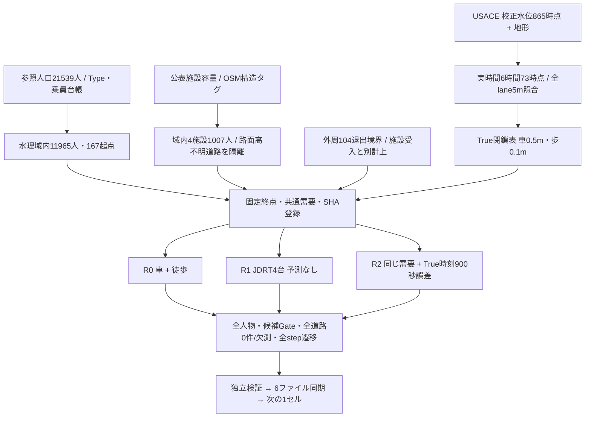

# 常総市JDRT 実時間B 新データフロー v1

作成：2026-10-16T07:09:25.885042+09:00。ユーザー採用Bの独立図解。旧v1は判断前の履歴として保存。

入力独立15検査PASS、車両閉鎖修正版のR0/R1/R2 smoke独立PASS、境界・会計・記録18テストPASS。これは開始準備の状態であり本実験15セルの完了を意味しない。進行正本は[context](../../context.md)。

新水位は2015校正水理計算、地形との比較から派生する道路閉鎖である。現在の災害行動・車両確保・利用50%・全員避難意図は仮定。域内Type4全544人を主分母とし、退出を施設受入へ加えない。橋梁等除外はモデル適用範囲の制約である。結果を全市の安全な避難完了と呼ばない。

[PAP](../jdrt/常総市JDRT_実時間B_PreAnalysisPlan_v1.md)・[Parameter Registry](../jdrt/常総市JDRT_実時間B_ParameterRegistry_v1.md)・[技術準備監査](../../05_タスク管理/jdrt/JDRT-実時間B_開始準備監査.md)・[HTML版](JDRT_実時間B_新データフロー_v1.html)

現在の本実験は時刻境界の判断待ちでHOLD。18テスト・3条件smokeのPASSは技術fixtureの実績であり、R2 seed1フル条件の境界不合格を覆さない。時刻境界・再開判断案_v1とcontext.mdを参照。
