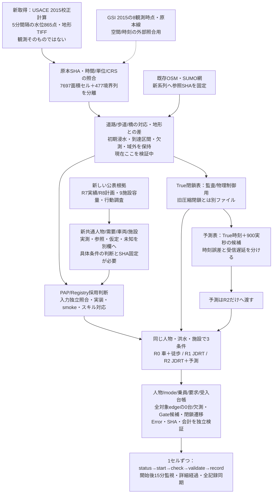
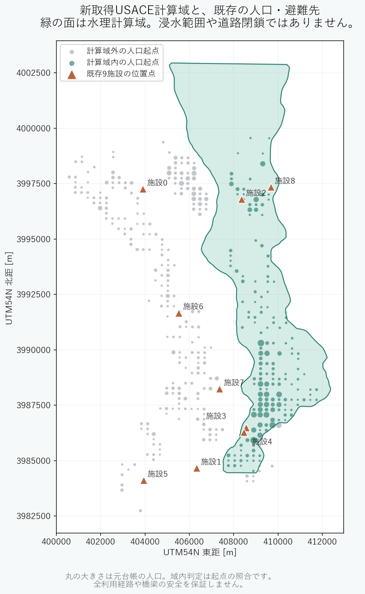

# JDRT 実時間版・新データを加えたデータフロー v1

作成：2026-10-15。旧[データフロー図](データフロー図.md)を保全した独立ファイル。[独立HTML図解](JDRT_実時間版_新データフロー_v1.html)と対になる。**候補入力の流れであり、新シミュレーションは未開始。** 方法の具体案は[開始前判断案](../jdrt/常総市JDRT_実時間版_開始前判断案_v1.md)。

| データ | 位置づけ | 主な限界・現在の状態 |
|---|---|---|
| USACE HDF/地形 | 新取得の再現計算・洪水入力候補 | 5分保存と実到達時刻の精度は別。橋梁高・域外・初期状態の変換は未完 |
| GSI KML/PDF | 2015の観測資料・外部照合 | 原本は線、8時点。水深や15分の全域観測ではない |
| 浸水ナビBP030 | L2想定の単位/形式を調べた資料 | 2015再現の本入力には使わない |
| 旧v2閉鎖/旧R0 | 完了結果・監査参照 | 圧縮時間、距離分位シナリオ。新実時間入力へ混ぜない |
| Scenario C人口/乗員 | 新共通人物版の参照候補 | 現在人口/災害時行動の実測ではない。Type4は新系列内で同一分母にする |
| 交通・施設・行動の公表資料 | 実績/計画と仮定を分離する根拠 | 4台の災害時確保、全施設の即時開設、JDRT利用率は実測未取得 |
| 新観測台帳 | v2取得不足を補う実装仕様 | 候補Gate拒否・全車両閉鎖後進入は旧出力から復元済みとはしない |

実ファイルと監査は[USACE取得・入力化監査](../../02_情報調査/氾濫・浸水/jdrt_realtime_20261015/USACE_取得・入力化監査.md)。表示の状態は作成時点のスナップショット。現在地の正本は[context.md](../../context.md)。外部通信は公開資料の読み取りのみ。Drive編集・問い合わせ・メール送信・Dropbox送信・公開更新なし。

## 計算域と既存入力の位置照合

[拡大用SVG](JDRT_実時間版_計算域照合_v1.svg)。元データSHAは同名metadata JSON。人口起点の域内判定であり、経路・施設安全性の判定ではない。
