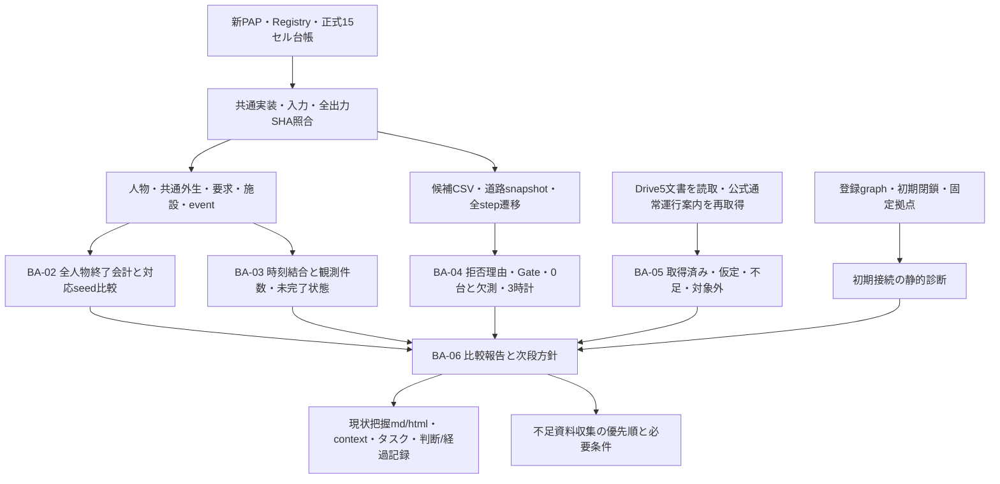

# 境界整合B：完了後の集計・監査フロー

2026-10-17。新たな研究入力を追加した図ではなく、凍結済み15セルからの派生成果物の関係を示す。旧B8セルは含めない。

主指標の分母は全Type4。退出は施設受入に加えない。観測できた時間だけの平均を全要求者の効果としない。snapshotは60秒ごとの瞬間値。新しい条件・推定量・runは追加していない。研究方法の変更は、根拠・代替案・影響を整理して別途判断・事前登録する。

[副指標報告](副指標・観測監査報告.html)・[取得監査](データ取得監査.md)・[独立一次一覧](../全セル結果一覧.html)・[詳細実行履歴](operations.jsonl)。
